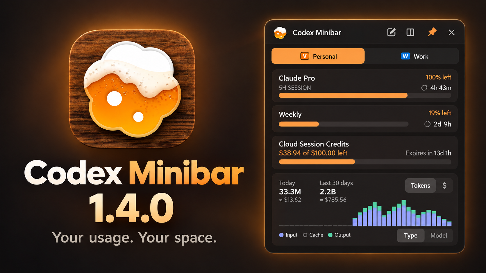

**Статистика там, где удобно.** Открепите Minibar в плавающую панель, перемещайте её между мониторами и закрепляйте поверх других приложений.

- Меняйте высоту обоих видов попапа без лишнего пустого места. Home и Usage поддерживают две колонки; вкладки провайдеров остаются компактными.
- Новая панель объединяет редактирование, колонки, пин и закрытие. В обычном попапе её можно скрыть в Настройках > Вид окна > Макет.
- **Tibo Reset improvements:** карточки forced и banked reset теперь показывают, получил ли каждый аккаунт Codex анонсированный сброс.
- Исправлено отображение квот Antigravity: показывается фактическое использование подписки.
